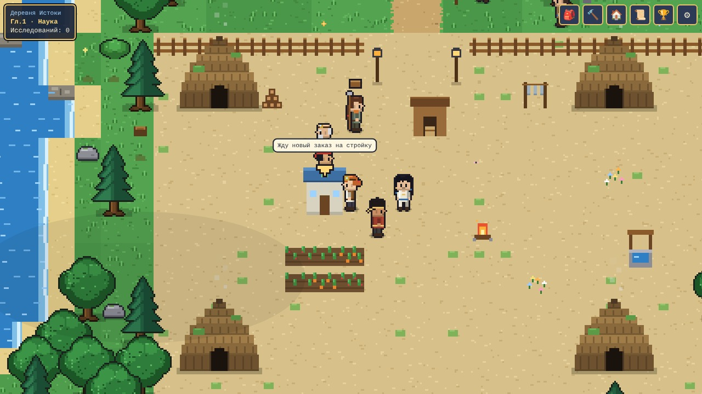
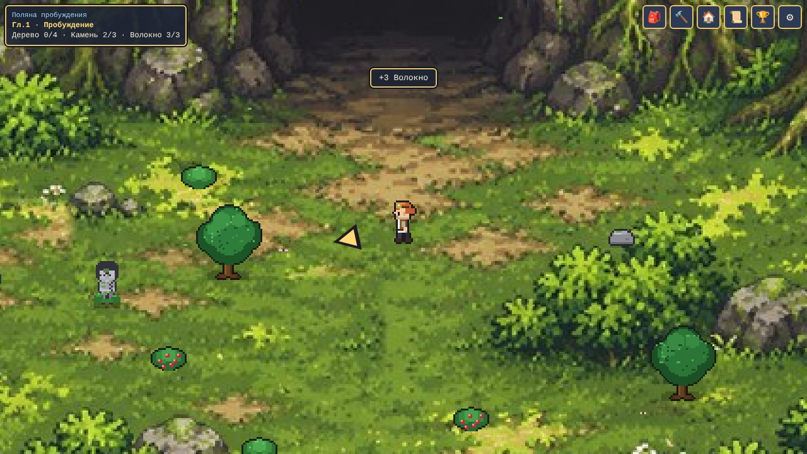
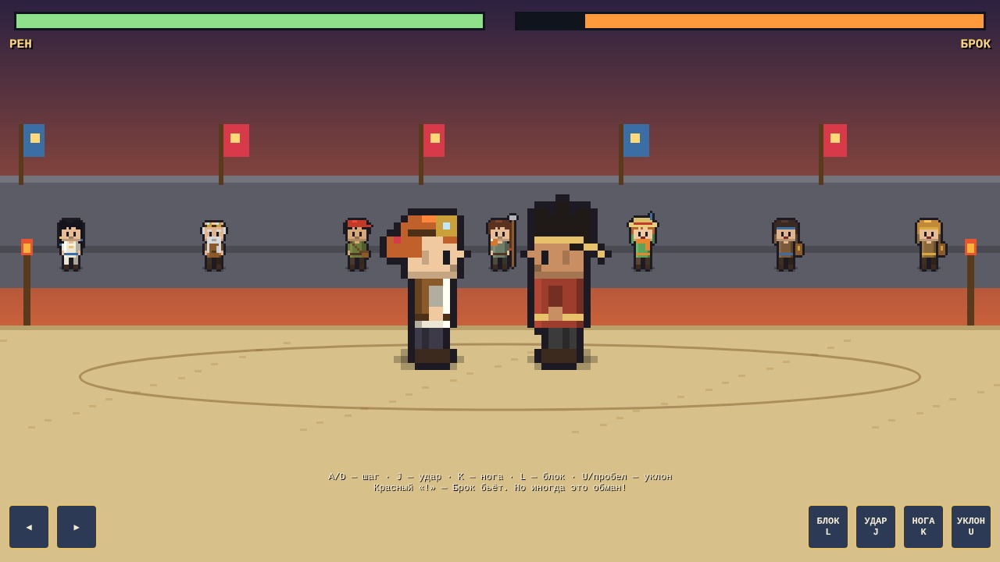
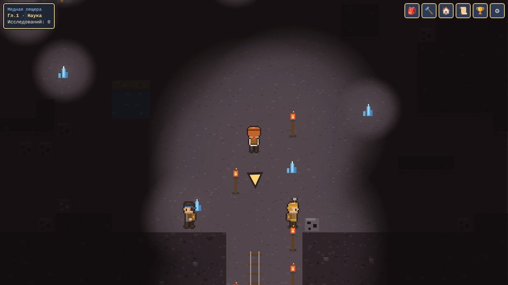
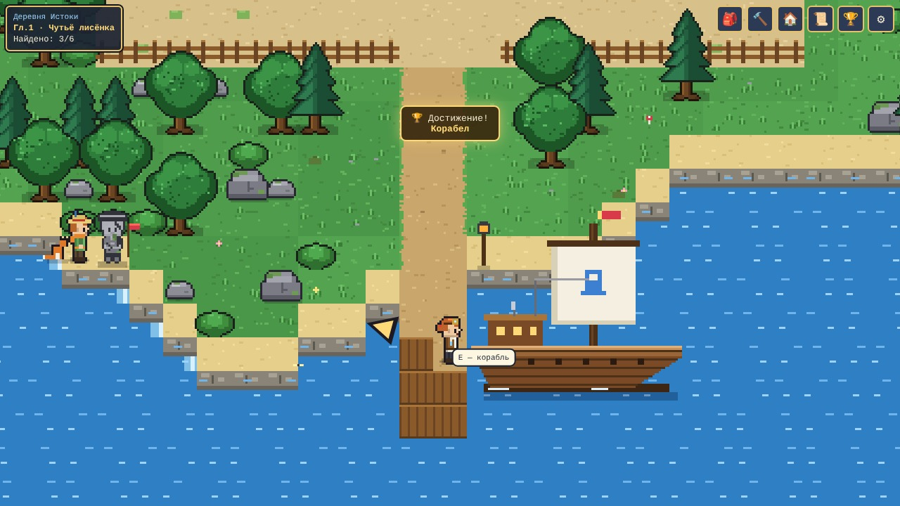
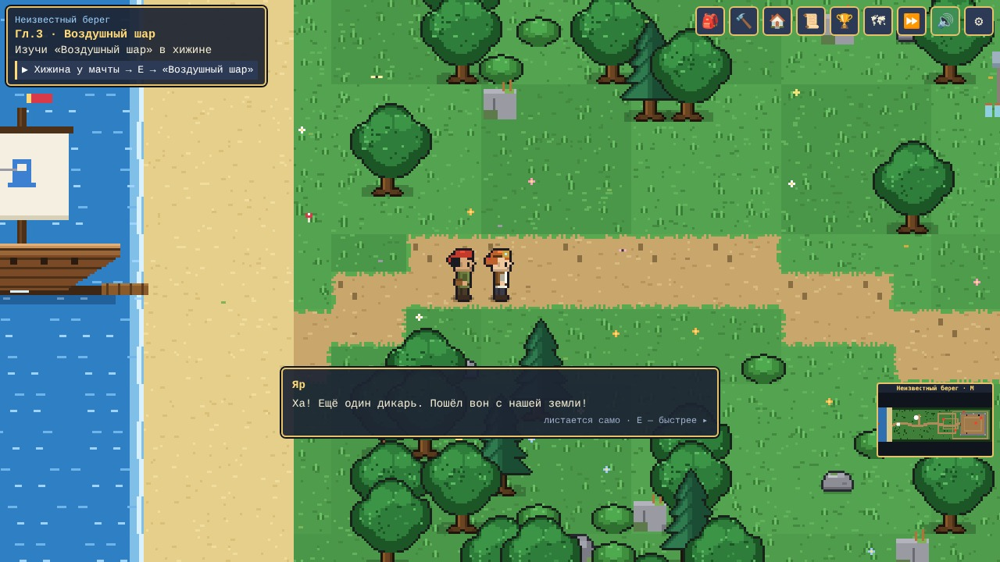
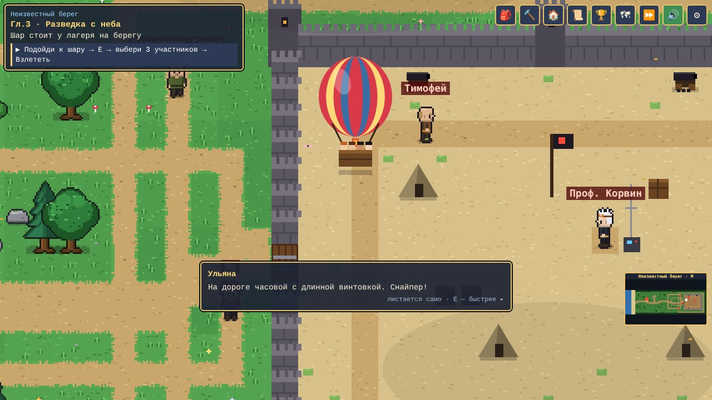

# Эра Искры

**Gambit Hackathon 2026 · трек «AUTOMATE IT!»**

▶ **Играть в браузере:** https://gumarahmetkaliev-ai.github.io/era-iskry/
🎬 **Видео-демо (2:21, с субтитрами):** [docs/video.mp4](docs/video.mp4)
📊 **Презентация:** [docs/presentation.pdf](docs/presentation.pdf)

## Название и команда

| | |
| --- | --- |
| Игра | Эра Искры |
| Команда | [Название команды] |
| Школа, город | [Школа], [Город] |
| Состав | [Имя Фамилия] — капитан; [Имя Фамилия]; [Имя Фамилия] |
| Контакт капитана | [Telegram / e-mail] |

## О чём игра

**Жанр:** 2D pixel-art RPG + колония: менеджмент работников и производственных цепочек.

**Одной фразой:** человечество обратилось в камень, а юный учёный Рен оживляет людей и выстраивает с ними систему, которая сама добывает, перерабатывает и строит.

**Что автоматизирует игрок.** Он оживляет жителей и раздаёт им одну из 11 профессий: лесоруб, каменотёс, собиратель, шахтёр руды, шахтёр угля, повар, разведчик, реставратор, помощник, носильщик, защитник. Дальше жители работают сами:

- сами ищут ресурс по карте (поиск пути BFS), добывают его и несут на общий склад;
- мастер Тарас сам приходит к стройке и строит то, что заказал игрок, — от печи до корабля и воздушного шара;
- носильщики сами возят материалы со склада на стройку, а повар кормит жителей, и те работают быстрее.

**Как автоматизация влияет на прогресс.** Корабль, лаборатория и шар требуют сотни ресурсов. Собирать их руками — долгие минуты, а с налаженной системой склад наполняется сам. Улучшения — тележки, медные инструменты, платиновый катализатор, больше работников — ускоряют всю цепочку.

**Три вопроса теста на автоматизацию:**

1. *Убрать автоматизацию — игра сломается?* Да. Строит только мастер, а ресурсы для корабля без работников собирать слишком долго.
2. *Можно ли улучшить систему, когда она уже работает?* Да: исследования (тележки ×2 груза, медные инструменты), новые работники, носильщики, распределение профессий.
3. *Есть ли результат без постоянного ручного ввода?* Да. Склад пополняется и стройки идут, пока игрок занят своими делами или просто стоит.

**Цель, победа и счёт:** 27 заданий в трёх главах (последнее — подготовка к войне с крепостью), 30 достижений, 6 каменных людей, которых нужно найти и оживить. Поражение возможно в бою на арене, а часовые врага ловят игрока и отбрасывают его назад.

## Как играть

| Клавиша | Действие |
| --- | --- |
| WASD / стрелки | Ходьба |
| Shift | Бег |
| E / пробел | Действие: собрать, поговорить, войти |
| I / C / B / Q | Инвентарь / крафт / стройка / задания |
| M | Карта мира |
| P | Пауза и меню: звук, скорость, титры, выход |
| R | Арсенал врага (глава 3) |
| J / K / L / U | В бою: удар / нога / блок / уклон |

На телефоне есть экранный джойстик и кнопки «Действие» и «Бег». Мышью можно нажимать все кнопки интерфейса.

**Обучение:** в первые секунды открывается большая табличка с заданием. В углу экрана всегда написано «▶ что делать сейчас», жёлтая стрелка ведёт к цели, а мини-карта и карта мира показывают путь.

**Длительность:** первый работник появляется примерно через 5 минут, первая глава занимает около 25–40 минут, вся игра — 1,5–2 часа. Прогресс сохраняется автоматически.

## Запуск

- **Web:** открой https://gumarahmetkaliev-ai.github.io/era-iskry/ в Chrome или Firefox.
- **Локально:** скачай репозиторий (Code → Download ZIP) и открой `build/web/index.html` двойным щелчком. Сервер, установка и интернет не нужны.
- **Сборка из исходников:** не требуется. Исходник `src/index.html` и есть готовая игра, `build/web/index.html` — его копия для публикации.

## Технологии

| | |
| --- | --- |
| Движок | Собственный, на HTML5 Canvas 2D |
| Язык | JavaScript (ES2020), HTML5, CSS |
| Библиотеки | Нет |
| Графика | Пиксельные персонажи, тайлы и анимации рисуются кодом во время запуска |
| Звук | Синтез эффектов через Web Audio API, аудиофайлов нет |
| Сохранение | localStorage браузера |
| Нетривиальные системы | Поиск пути BFS для жителей и ИИ работы, машина состояний работников (поиск → добыча → доставка), генерация пещеры, save/load, файтинг с ИИ противника |
| ИИ-инструменты | Claude (Anthropic) — помощь в написании кода. Подробности в [third_party.md](third_party.md) |

## Лицензии

- **Код и графика**, нарисованная кодом, — команда, © 2026. Права на решение в рамках хакатона — по правилам HackHub.
- **Фон «Поляны пробуждения»** — из прототипа участника команды, используется с разрешения автора.
- **Звук** — синтезируется в игре, сторонней музыки нет.
- **Шрифты** — системные шрифты браузера, в игру не встроены.

Полный список — в [third_party.md](third_party.md).

## Известные баги

- Глава 3 заканчивается подготовкой к войне: штурма крепости и финала с ракетой пока нет.
- Сохранение хранится в браузере. Если очистить данные сайта, прогресс пропадёт; «Продолжить» работает только в том же браузере.
- Жители иногда проходят сквозь декоративные объекты.
- Звук включается после первого нажатия клавиши или клика — так требуют браузеры.
- Если персонаж застрял в постройке, сделай шаг в любую сторону: игра выталкивает его на свободную клетку.

## Видео

`docs/video.mp4` смонтировано из реального геймплея этой версии игры. Для краткости часть сбора ресурсов и ожидания пропущена, а некоторые сцены ускорены.

## Devlog

- **10 ноября:** [что сделали — заполнить команде]
- **11 ноября:** [что сделали — заполнить команде]
- **12 ноября:** работники и склад, стройка руками мастера, шахта, оживление каменных людей, бой на арене, корабль, море, радио и радар. Глава 3: крепость, враги-часовые, воздушный шар, арсенал. Карта мира и мини-карта, формулы в рецептах, понятные подсказки, звук, бег, ускорение времени, пауза и титры. Видео, презентация, публикация на GitHub Pages.

## Скриншоты

| | |
| --- | --- |
|  |  |
|  |  |
|  |  |
